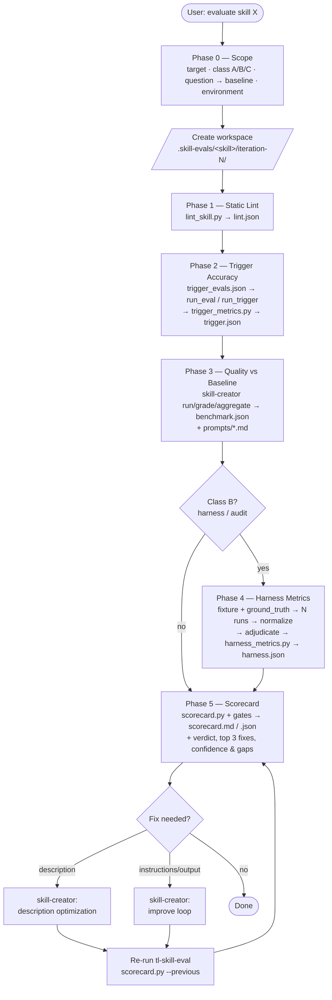
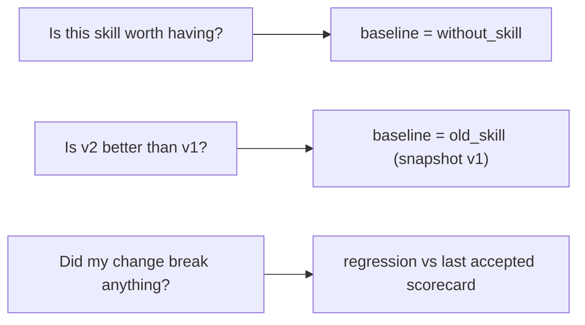
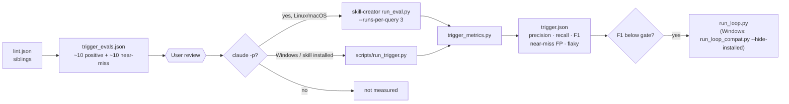
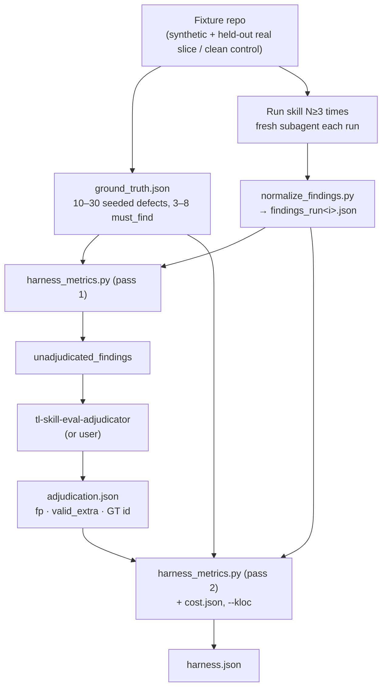
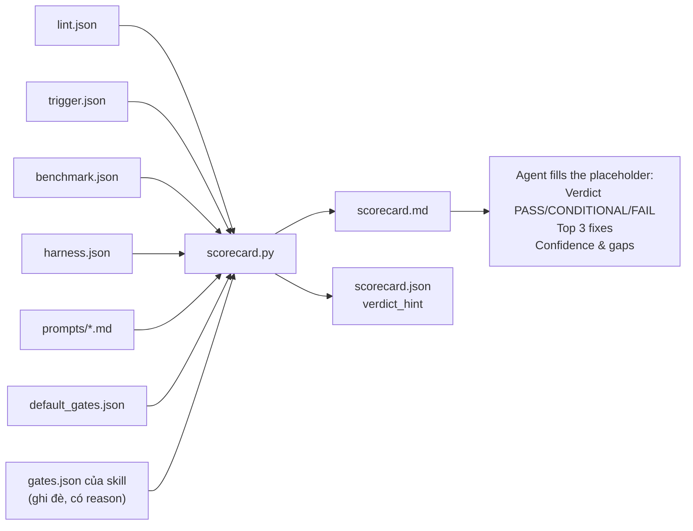

# tl-skill-eval — How It Works

Tài liệu cho người dùng: tl-skill-eval chạy qua những bước nào, mỗi bước cần gì và cho ra file gì. Quy tắc đầy đủ mà agent làm theo nằm trong tệp SKILL chính của thư mục này; tài liệu này chỉ tóm tắt để dễ hình dung, agent không đọc nó.

## Contents
1. Core Principles
2. Workflow Overview
3. Phase 0 — Scope
4. Phase 1 — Static Lint
5. Phase 2 — Trigger Accuracy
6. Phase 3 — Output Quality vs Baseline
7. Phase 4 — Harness Metrics (class B only)
8. Phase 5 — Scorecard & Verdict
9. Workspace Layout
10. Environment Capabilities
11. Usage Examples

## 1. Core Principles

- **Evaluate like software**: có baseline, chạy lặp nhiều lần (N≥3), dùng dữ liệu held-out, và mọi con số đều tính lại được.
- **Scripts count, agents judge**: mọi số trong scorecard do script Python (stdlib) tính từ file trong workspace. Agent chỉ viết eval set, chạy skill và phân xử (adjudicate).
- **Never estimate**: không đo được thì ghi `not measured`, không bao giờ ước lượng hay tự mô phỏng.
- **Division of labour with skill-creator**: skill-creator là *execution engine* (chạy with-skill/baseline, chấm assertion, gộp `benchmark.json`, trigger eval, tối ưu description). tl-skill-eval lo *measurement design, metrics, gates và verdict*.

## 2. Workflow Overview



Class của skill quyết định phase nào chạy:

| Class | Examples | Phases |
|---|---|---|
| A. Single-output | tạo tài liệu, viết bài, formatter | 0 → 1 → 2 → 3 → 5 |
| B. Harness / audit | tl-code-refactor, tl-security-audit, tl-architecture-doc | 0 → 1 → 2 → 3 → **4** → 5 |
| C. Workflow / tool-use | deploy, data pipeline | 0 → 1 → 2 → 3 (assert trên file/side effect) → 5 |

## 3. Phase 0 — Scope

Agent lấy thông tin từ hội thoại trước, chỉ hỏi phần còn thiếu:

| Input | Decides |
|---|---|
| Target | Đường dẫn skill (và bản cũ nếu so sánh) — đối tượng đo |
| Skill class (A / B / C) | Nhóm metric áp dụng |
| Question | Baseline dùng để so sánh |
| Environment (Claude Code / Cowork / claude.ai) | Metric nào đo thật được |



**Workspace location**: đặt **ngoài** cây `skills/` (`<repo>/.skill-evals/<skill>/iteration-N/`, thêm vào `.git/info/exclude`), vì bản snapshot `old_skill/` có tệp SKILL trùng tên và sẽ làm installer thấy hai skill giống nhau.

## 4. Phase 1 — Static Lint

Luôn chạy, rẻ, không cần model.

```bash
python scripts/lint_skill.py <skill> [<module> …] --siblings <skills-root> [--name-prefix tl-] --json <ws>/lint.json
```

- **Errors** (chặn verdict PASS): tên sai định dạng, description > 1024 ký tự, nhiều hơn một tệp SKILL, frontmatter sub-agent lỗi.
- **Warnings** (đưa vào khuyến nghị): body > 500 dòng, reference lồng quá 1 cấp, file > 100 dòng không có mục lục, đường dẫn Windows, thiếu tín hiệu "khi nào dùng"…
- **Stale user guide**: nếu skill có `WORKFLOW.md`, lint dùng git để cảnh báo khi SKILL.md có commit mới hơn guide, hoặc SKILL.md đang sửa dở mà guide thì không.
- **Info**: ước lượng token theo 3 tầng (description luôn nằm trong context, body khi trigger, references khi cần; `WORKFLOW.md` không được tính vì agent không đọc nó), trùng lặp câu giữa các skill trong cùng family, danh sách **siblings** có description gần giống — nguồn cho câu hỏi near-miss ở Phase 2.
- **Reviewer notes**: agent tự đọc skill để ghi nhận xét, ghi rõ đây là nhận định, không phải số đo.

## 5. Phase 2 — Trigger Accuracy

Đo xem skill có được gọi đúng lúc không.



- **Near-miss**: câu hỏi chung từ khóa nhưng thuộc về skill khác; chúng mới thật sự kiểm tra description. Câu phủ định dễ chỉ làm precision đẹp giả.
- **Repo state**: câu hỏi nhắc tới staged diff, một commit, một thư mục phải chạy trong `--cwd` có đúng trạng thái đó. Thư mục rỗng khiến Claude kiểm tra, không thấy gì và tự trả lời, nên false negative là lỗi của fixture. Xem cột `fired` trước khi sửa description.
- **Flaky query**: tỉ lệ trigger nằm giữa 0 và 1 → description đang ở ranh giới.
- **Low F1**: dùng vòng tối ưu description của skill-creator, không sửa tay trước.

## 6. Phase 3 — Output Quality vs Baseline

Dùng nguyên workflow run/grade/aggregate của skill-creator. tl-skill-eval bổ sung:

- **Eval set**: 3–10 prompt thực tế (main path, edge case, ít nhất 1 case skill phải từ chối hoặc giữ phạm vi hẹp); giữ 30–40% làm **held-out**.
- **Discriminating assertions**: mỗi assertion phải có khả năng fail; assertion pass ở cả hai cấu hình là không phân biệt được → bỏ hoặc siết lại.
- **Runs per config ≥ 3**: delta chỉ có ý nghĩa khi lớn hơn khoảng độ lệch chuẩn gộp.
- **Prompt log**: ghi lại mọi prompt (kể cả baseline) vào `prompts/` *trước khi* chạy — nguyên văn và cách gửi (subagent nào, cờ `claude -p` nào). Không có prompt baseline thì con số baseline không review hay tái lập được.
- **No subagents (claude.ai)**: chỉ chạy with-skill, `quality_delta` = `not measured`.

## 7. Phase 4 — Harness Metrics (class B only)

Đo một skill audit tìm lỗi tốt đến đâu, trên fixture có **seeded defects** (lỗi được gieo sẵn).



- **Normalization**: `normalize_findings.py` tự nhận dạng output của tl-architecture-doc, tl-code-refactor, tl-security-audit; bỏ các finding mà verifier của chính skill đã loại; ghi lại bảng ánh xạ severity. Skill khác cần một converter nhỏ theo schema trong `references/schemas.md`.
- **Matching**: cùng file, dòng chồng nhau (±3), category hoặc alias khớp. Finding lặp lại một lỗi đã tìm thấy được gắn `dup:<GT id>` và không tính vào TP/FP.
- **Adjudication**: trên code thật, "không có trong ground truth" không có nghĩa là false positive. Adjudicator là agent chưa từng chạy skill.
- **Baseline comparison**: để trả lời "harness có đáng không", chạy thêm baseline (Claude review fixture không dùng skill) qua cùng pipeline.

| Metric | Meaning |
|---|---|
| Seeded recall / must_find recall | Tìm được bao nhiêu lỗi gieo; lỗi must_find bị bỏ sót được nêu tên |
| Precision / FP rate | Chỉ tính trên finding đã phân xử |
| Reproducibility (Jaccard, stable core) | Các lần chạy có ra cùng kết quả không |
| Severity kappa | Mức độ nghiêm trọng có đúng không (cần ≥ 8 cặp TP; severity của ground truth phải gắn theo rubric của chính skill) |
| Cost | Token, thời gian mỗi run và mỗi KLOC |

## 8. Phase 5 — Scorecard & Verdict

```bash
python scripts/scorecard.py --workspace <ws> --skill-name <name> \
  [--gates references/default_gates.json] [--previous <old>/scorecard.json] --out <ws>/scorecard.md
```



- **Missing inputs**: file nào thiếu thì phần đó là `not measured`.
- **verdict_hint**: tính cơ học — có error/fail → FAIL, có warn → CONDITIONAL. Verdict cuối do agent viết, kèm lý do và 1–2 metric quyết định.
- **Default gates**: `references/default_gates.json` chỉ là điểm khởi đầu; skill bảo mật nên ưu tiên recall, skill nội dung ưu tiên precision.
- **Gate riêng cho từng skill**: đặt `gates.json` ở thư mục eval gốc của skill (thư mục cha của workspace), mỗi mục ghi đè phải có `reason`. Scorecard gộp theo metric và in lý do. Chỉ đổi gate khi đã có số đo cho thấy mặc định không phù hợp.

| Gate | Fail | Warn |
|---|---|---|
| lint.errors | > 0 | — |
| trigger.recall / precision | < 0.7 | < 0.85 |
| trigger.near_miss_fp_rate | > 0.4 | > 0.2 |
| quality.pass_rate_delta | < 0 | < 0.15 |
| quality.with_skill_pass_rate | < 0.6 | < 0.8 |
| harness.must_find_recall | < 0.8 | < 1.0 |
| harness.seeded_recall | < 0.5 | < 0.7 |
| harness.precision | < 0.6 | < 0.8 |
| harness.reproducibility_jaccard | < 0.4 | < 0.6 |
| harness.severity_kappa | < 0.2 | < 0.4 |

## 9. Workspace Layout

```text
<repo>/.skill-evals/<skill>/iteration-N/
├── lint.json                 Phase 1
├── trigger_evals.json        Phase 2 — eval set
├── trigger_run.json          Phase 2 — output của run_eval / run_trigger
├── trigger.json              Phase 2 — metrics
├── <skill-creator runs>/     Phase 3 — with_skill/, baseline/, grading.json, benchmark.json
├── prompts/                  Phase 3–4 — prompt nguyên văn đã gửi (baseline, with_skill, grader)
├── ground_truth.json         Phase 4 (class B)
├── findings_run1..N.json     Phase 4
├── adjudication.json         Phase 4
├── cost.json                 Phase 4
├── harness.json              Phase 4
├── scorecard.md              Phase 5 — cho người đọc
└── scorecard.json            Phase 5 — cho regression diff
```

## 10. Environment Capabilities

| Capability | Claude Code | Cowork | claude.ai |
|---|---|---|---|
| Static lint | có | có | có |
| Trigger eval (`claude -p`) | có | có | **không** |
| Description optimization | có | có | **không** |
| Parallel baseline (subagents) | có | có | **không** |
| Independent grader | có | có | không (tự chấm, ghi rõ bias) |
| Harness metrics | có | có | có, nếu có sẵn file findings |

**Windows notes**: dùng `run_trigger.py` thay `run_eval.py`, `run_loop_compat.py --hide-installed` thay `run_loop.py`, và đặt `PYTHONUTF8=1` khi chạy script của skill-creator như `aggregate_benchmark.py`. Chi tiết trong `references/environments.md`.

## 11. Usage Examples

Chỉ cần nói tự nhiên trong Claude Code, ví dụ:

- "Đánh giá skill tl-seo-audit" → class B, baseline `without_skill`.
- "So sánh tl-code-review bản hiện tại với commit abc123" → baseline `old_skill`.
- "Skill tl-goal-griller có trigger đúng không?" → chủ yếu Phase 1–2.
- "Chấm lại tl-security-audit sau khi sửa description" → chạy lại, `--previous` để so scorecard.

**References** — tài liệu tham khảo sâu hơn:

- `references/metrics.md` — định nghĩa metric, lỗi diễn giải thường gặp.
- `references/fixtures.md` — xây fixture và ground truth.
- `references/schemas.md` — định dạng các file JSON.
- `references/environments.md` — môi trường, lưu ý cho Windows.
